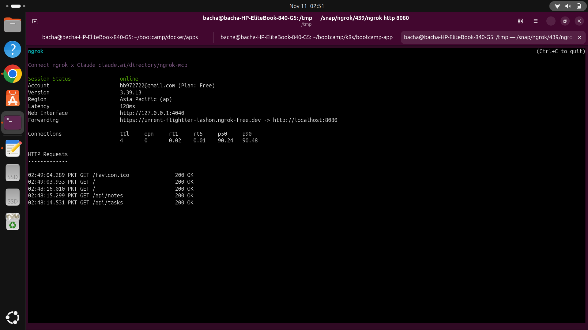
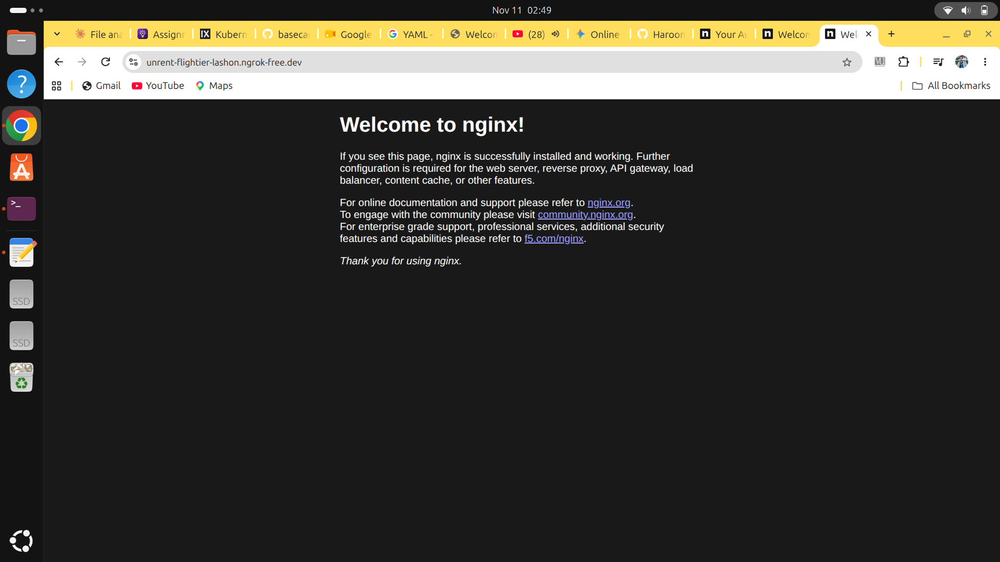

# Bootcamp App on Kubernetes

A three-service app (web, notes API, tasks API) with a PostgreSQL database, deployed on a local Kubernetes cluster (kind) with Traefik as the Ingress controller.

**Live demo (while the tunnel is running):** https://unrent-flightier-lashon.ngrok-free.dev

## Architecture

| Component | Kind | Purpose |
|---|---|---|
| db | StatefulSet + headless Service + PVC | PostgreSQL 18, one replica |
| tasks | Deployment + Service | Tasks API (FastAPI), 2 to 6 Pods via HPA |
| notes | Deployment + Service + ConfigMap | Notes API (Flask), 2 to 6 Pods via HPA |
| web | Deployment + Service + ConfigMap | Web site (nginx) |
| front door | Traefik Ingress + strip-prefix Middleware | Routes `/`, `/api/notes`, `/api/tasks` |
| migrate | Job | Creates the tasks table before the API starts |

## Deploy from scratch

Prerequisites: Docker, kind, kubectl, Helm.

```bash
# 1. Create the cluster
kind create cluster --config kind-config.yaml
kubectl create namespace bootcamp
kubectl config set-context --current --namespace=bootcamp

# 2. Install Traefik and metrics-server
helm repo add traefik https://traefik.github.io/charts
helm install traefik traefik/traefik --version 42.3.0 \
  --namespace traefik --create-namespace -f traefik-values.yaml
kubectl apply -f https://github.com/kubernetes-sigs/metrics-server/releases/download/v0.9.1/components.yaml

# 3. Build and load the images
docker build -t notes-api:1.3.0 ./notes-api-app
docker build -t tasks-api:1.0.0 ./tasks-api-app
kind load docker-image notes-api:1.3.0 tasks-api:1.0.0 --name bootcamp

# 4. Create the Secret with your own password (never commit it)
kubectl create secret generic db-credentials \
  --from-literal=POSTGRES_USER=app \
  --from-literal=POSTGRES_PASSWORD='choose-your-own' \
  --from-literal=POSTGRES_DB=tasks

# 5. Deploy the app in order: database, then the migration, then the services
kubectl apply -f k8s/db.yaml
kubectl rollout status statefulset db
kubectl apply -f k8s/migrate-job.yaml
kubectl wait --for=condition=complete job/tasks-migrate --timeout=120s
kubectl apply -f k8s/notes.yaml -f k8s/tasks.yaml -f k8s/web.yaml -f k8s/ingress.yaml -f k8s/hpa.yaml
```

## Verify

```bash
kubectl get deploy,sts,svc,ingress,pvc,pods -o wide
curl -s localhost:8080/api/tasks; echo
curl -s localhost:8080/api/notes; echo
```

## Screenshots

Requests through the public tunnel, all returning `200 OK`:



Web site served through the public URL:



## Deviations from the handbook

- **Web site:** `nginx:alpine` with the handbook's ConfigMap, instead of the React build.
- **Notes API:** a Flask app on port 5000 (Service on port 3000), with an in-memory `/api/notes` route, instead of the Node.js app on port 3000.
- **Public URL:** ngrok tunnel instead of nginx on a VM with a domain. The tunnel only works while it is running.
- **Traefik:** one replica. A drain test showed this is a single point of failure.

## Known limits

- The tasks API has no authentication. Anyone with the public URL can read and change tasks.
- The database has one replica and no automated backups off the cluster.
- The development password is never stored in this repository.
